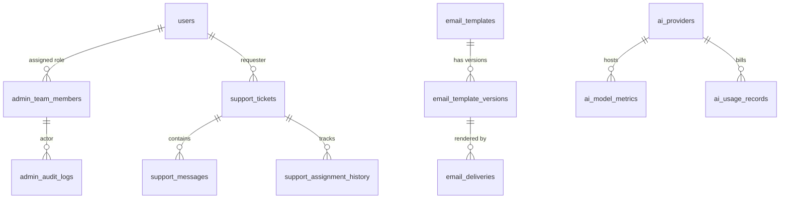

# AI Tathastu — Admin Operating System Architecture

**Document:** Architecture Design & Systems Specification  
**Version:** 1.0  
**Scope:** Super Admin Control Center, Support Operations, Email Template Studio, AI Observability & Platform Management  

---

## 1. System Topology & Navigation Architecture

The Super Admin Control Center is accessible under `/admin` and seamlessly integrates into the AI Tathastu navigation while remaining completely invisible to unauthorized users via stealth 404 rewriting in [`src/proxy.ts`](file:///e:/dev/ai-tathastu/src/proxy.ts) and [`src/auth.config.ts`](file:///e:/dev/ai-tathastu/src/auth.config.ts).

### Navigation & Layout Hierarchy

```
/admin
├── /overview                   ── Overview & Platform Health Pulse
├── /tickets                    ── Support Operations & Ticket Management
│   ├── /tickets/[id]           ── Ticket Detail (Conversation, Private Notes, Timeline, SLAs)
│   └── /tickets/new            ── Admin Manual Ticket Creation
├── /students                   ── Student Directory & Account Management
│   └── /students/[id]          ── Student Detail, Sessions, Linked Sources, Audit History
├── /team                       ── Admin Roles, Permissions & Team Management
├── /emails                     ── Email Platform Management
│   ├── /emails/templates       ── Email Template Studio (Visual/HTML Editor, Variable Registry)
│   │   └── /emails/templates/[id] ── Template Detail, Versions & Previews
│   ├── /emails/deliveries      ── Delivery Outbox & Webhook Tracking
│   └── /emails/settings        ── Global Email Branding & Sender Profiles
├── /automation                 ── Notification Rules & SLA Automation
├── /kb                         ── Support Knowledge Base & Help Articles
├── /ai-ops                     ── AI Observability & Model Operations
│   ├── /ai-ops/providers       ── Provider & Model Registry, Health Telemetry, Circuit Breakers
│   └── /ai-ops/costs           ── Usage Metrics, Cost Accounting & Budget Policies
├── /logs                       ── Application Telemetry & Security Audit Trail
├── /cms                        ── Website CMS, Banners & Announcements
├── /newsletter                 ── Newsletter Campaigns & Subscriber Directory
├── /flags                      ── Feature Flags & System Maintenance Controls
├── /system                     ── Operational Health, Background Jobs & Integrations
└── /institutions               ── Academic Catalog Review (Existing Module Preserved)
```

The admin layout features:
1. **Collapsible Searchable Sidebar:** Grouped by Operational Domain (Operations, People & Security, Communications, Intelligence, Platform).
2. **Top App Bar:** Current admin identity, active role badge, quick search shortcut (`Ctrl+K`), system health indicator, theme toggle, and exit-to-student-app link.
3. **Breadcrumbs & Page Header:** Consistent typography, page title, summary, action buttons (create, export, filter).
4. **Responsive Content Surface:** Optimized for desktop (1440px/1280px), tablet (1024px/768px), and mobile (320px-430px) without horizontal overflow.

---

## 2. Role-Based Access Control (RBAC) & Security Architecture

### 2.1 Role Definitions
We define 7 administrative roles with fine-grained action-level permissions:

| Role Name | Description | Key Capabilities |
| :--- | :--- | :--- |
| `super_admin` | Global platform administrator | Full access to all resources, permissions, team assignments, deletion workflows, and system settings. |
| `support_admin` | Head of support operations | Manages tickets, SLA policies, ticket routing, assignments, canned responses, and support analytics. |
| `support_agent` | Customer support representative | Views assigned tickets, replies to students, adds internal notes, updates ticket statuses, creates tickets. Strictly prohibited from seeing other agents' private notes or raw credentials. |
| `ai_ops_admin` | AI & ML platform engineer | Manages model routing, provider API keys status, circuit breakers, fallback policies, token limits, and AI kill-switches. |
| `finance_admin` | Cost and budget controller | Monitors AI token expenditure, provider invoices, budget alerts, and export financial summaries. |
| `content_editor` | CMS and marketing editor | Manages email templates, announcements, knowledge base articles, and newsletter campaigns. |
| `security_auditor` | Compliance and security officer | Read-only access to audit logs, session records, security events, and data deletion workflows. |

### 2.2 Granular Permissions Matrix

```typescript
export const ADMIN_PERMISSIONS = [
  // Support & Tickets
  "support.tickets.read",
  "support.tickets.create",
  "support.tickets.reply",
  "support.tickets.note",
  "support.tickets.assign",
  "support.tickets.escalate",
  "support.tickets.close",
  "support.rules.manage",
  
  // Student Management
  "students.read",
  "students.restrict",
  "students.sessions.revoke",
  "students.delete.request",
  "students.delete.approve",
  
  // Team & RBAC
  "team.read",
  "team.manage",
  
  // Email Template Studio & Delivery
  "email.templates.read",
  "email.templates.edit",
  "email.templates.publish",
  "email.send.test",
  "email.delivery.retry",
  
  // AI & Model Operations
  "ai.providers.read",
  "ai.providers.manage",
  "ai.budgets.manage",
  
  // Logs & Security Audit
  "logs.read",
  "audit.read",
  
  // CMS, KB & Newsletter
  "cms.edit",
  "cms.publish",
  "kb.manage",
  "newsletter.manage",
  
  // Platform & Flags
  "flags.manage",
  "system.manage",
] as const;
```

### 2.3 Server-Side Enforcement Model
Every admin API endpoint, server action, and page load executes:
1. `requireAdmin()`: Enforces authentication and admin membership.
2. `hasPermission(user, permission)`: Evaluates whether the user's role or assigned permissions permit the requested action.
3. `recordAdminAudit()`: Creates an immutable record in `admin_audit_logs`.

---

## 3. Database Schema Extensions (Drizzle ORM)

The schema adds production-grade entities matching existing naming and type conventions:



### Key New Tables:
1. `admin_team_members`: Associates `userId` with role (`super_admin`, `support_admin`, etc.), custom permissions, status, and assignment teams.
2. `admin_audit_logs`: Append-only audit trail (`id`, `actorId`, `action`, `resource`, `targetId`, `diff`, `ipAddress`, `userAgent`, `createdAt`).
3. `support_tickets`: Support ticket header (`id`, `ticketNumber`, `requesterId`, `requesterEmail`, `subject`, `category`, `priority`, `status`, `assignedToId`, `slaDeadline`, `resolvedAt`, `createdAt`).
4. `support_messages`: Public replies and private internal notes (`id`, `ticketId`, `authorId`, `isInternalNote`, `content`, `createdAt`).
5. `email_templates` & `email_template_versions`: Server-backed template studio (`id`, `slug`, `name`, `category`, `activeVersionId`, versions with `subject`, `htmlBody`, `textBody`, `variables`, `status`).
6. `email_deliveries` & `email_delivery_events`: Transactional outbox for outgoing emails (`id`, `templateSlug`, `recipient`, `profile`, `status`, `attempts`, `nextAttemptAt`, `lastError`).
7. `ai_provider_telemetry`: Operational health, latency p95, error counts, and token usage for Groq, Gemini, and OpenRouter.
8. `ai_cost_budgets`: Configured thresholds, hard limits, and alert policies.
9. `knowledge_base_articles`: Public and internal support articles.
10. `cms_announcements`: Banner notifications, system maintenance alerts, and homepage highlights.
11. `newsletter_subscribers` & `newsletter_campaigns`: Consent-tracked subscriber directory and campaign runs.

---

## 4. Support Operations Lifecycle & SLA Engine

### 4.1 State Machine
```
[New] ──(auto-assign/claim)──> [Open] ──(agent starts)──> [In Progress]
  │                                                             │
  ├───(wait for student reply)──< [Waiting for Student] <───────┤
  │                                      │ (student replies)    │
  │                                      └─────────────>────────┤
  ├───(escalate)──────────────> [Escalated] <───────────────────┤
  │                                  │                          │
  └───(resolve)───────────────> [Resolved] <────────────────────┘
                                     │
                             (close after 48h)
                                     │
                                     ▼
                                  [Closed] ──(reopen)──> [Reopened]
```

### 4.2 Separation of Public Replies vs. Private Internal Notes
- Public replies update `support_messages` with `isInternalNote = false`, which queues a student notification email and is visible on the student-facing ticket tracking page (`/support/tickets/[id]`).
- Internal notes set `isInternalNote = true`. The database query for student views strictly filters `WHERE is_internal_note = false`. Internal notes are styled with a distinct amber background in the admin UI and are never exposed via student APIs.

---

## 5. Email Template Studio & Outbox Delivery Center

### 5.1 Template Engine & Variable Registry
A zero-eval, auto-escaped template rendering engine with approved dynamic variables:
- `student_name`, `ticket_id`, `ticket_subject`, `ticket_status`, `assigned_agent`, `resolution_summary`, `tracking_url`, `brand_name`, `support_email`.
- Input content is sanitized against XSS using strict entity escaping.

### 5.2 Transactional Outbox Pattern
Outgoing emails are written to `email_deliveries` in the same database transaction as the business event. An idempotent worker processes due rows with exponential backoff (1m, 5m, 15m, 1h), respects rate limits, and updates delivery statuses upon provider confirmation.

